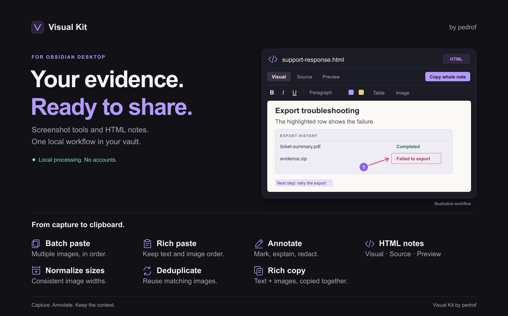

# Visual Kit

**Turn screenshots and rich text into clear, shareable notes.**

Capture evidence, annotate screenshots, edit HTML notes, and copy formatted responses between Obsidian and rich-text editors. Everything is processed locally in your vault.

Created by **[pedrof](https://github.com/pedrohf-dev)**.

[Download](https://github.com/pedrohf-dev/visual-kit/releases/latest) · [Support on Ko-fi](https://ko-fi.com/pedrohlf)



## Features

- **Batch paste** — insert several images at once, in their original order.
- **Rich paste** — keep text and images in order when pasting from email, web pages, and other rich-text editors. Public images can be imported into the vault; unavailable images show a warning and placeholder.
- **Annotate** — add arrows, shapes, text, numbered markers, highlights, and redactions.
- **Normalize** — give every image in a note or selection a consistent width.
- **Deduplicate** — reuse identical images instead of saving extra copies.
- **Rich copy** — copy formatted text and images together into a rich-text editor.
- **HTML notes** — create real HTML files with visual, source and preview modes; paste, edit and copy formatted responses with fonts, colors, tables and images.

Save annotated images as new PNGs, keep editable annotations, and undo or redo changes as you work. All image processing happens locally.

## Installation

Requires **Obsidian Desktop 1.8.0 or later**.

1. Download `main.js`, `manifest.json`, and `styles.css` from the [latest release](https://github.com/pedrohf-dev/visual-kit/releases/latest).
2. Place them in `<your-vault>/.obsidian/plugins/visual-kit/`.
3. Restart Obsidian and enable **Visual Kit** under **Settings → Community plugins**.

## Quick start

### Screenshots and Markdown

1. Paste screenshots into a note.
2. Right-click an image and choose **Annotate**.
3. Add your annotations and choose **Save as new**.
4. Run **Visual Kit: Normalize image sizes** to set a consistent width.
5. Select your documentation and run **Visual Kit: Copy with images**. Enable **Destination compatibility mode** for inline text and PNG images resized to their copied dimensions.

**Copy with images** uses your Markdown selection, or the whole note if nothing is selected. Formatting and image support depend on the destination editor.

### HTML notes and rich-text responses

1. Click **Add HTML note** beside **New note** in the file explorer, run **Visual Kit: Create HTML note**, or right-click a folder and choose **Create HTML note**. Type a name and press **Enter**; the `.html` extension is added automatically.
2. Paste a formatted response into **Visual** mode. Use the toolbar for text styling, lists, tables, and images.
3. Switch to **Source** to inspect HTML, or **Preview** for a read-only view. Changes autosave locally.
4. Select content and run **Copy as rich HTML**, or choose **Copy whole note** to export everything.
5. Paste into your destination editor and verify the saved result.

HTML notes are real `.html` files. Unsupported markup stays in Source mode to protect the original. See the [HTML notes guide](docs/html-notes.md) for image handling, recovery, compatibility, and known limits.

### Copying to Movidesk

For HTML formatting that survives save/reopen, run **Visual Kit: Create HTML note**. Paste into **Visual**, edit with the toolbar, then select content for **Copy as rich HTML** or use **Copy whole note**. HTML notes autosave and retain unsupported documents in Source mode to protect their original content. See the [HTML notes guide and manual acceptance checklist](docs/html-notes.md).

The options below describe Markdown **Copy with images**. HTML note copy preserves its own typography by default and has a separate destination compatibility opt-in.

Paste at the desired position inside your macro. Compatibility mode avoids outer blocks that can reset the destination font. If Movidesk still resets typography, set **Destination font**, **Destination font size (px)**, and **Destination text color** to match your macro; leave them empty for inheritance. Disable **Preserve formatting** if you also want to remove emphasis.

Use **Normalize image sizes on copy** for a consistent width, or **Preserve resize** to honor embed dimensions. Compatibility mode bakes that size into PNG pixels without modifying source files. GIF animation is flattened. Export SVG files as PNG before rich copying.

Images are embedded in clipboard HTML, not uploaded to Movidesk. If images disappear after saving or reopening a ticket, use Movidesk's image upload tool and verify the saved ticket. Copying cannot override destination security filters. Invalid images leave the clipboard unchanged with a named error. Large batches may need to be split.

### Editor shortcuts

| Shortcut                         | Action                               |
| -------------------------------- | ------------------------------------ |
| `V` / `A` / `R` / `E`            | Select / arrow / rectangle / ellipse |
| `T` / `D` / `N` / `H`            | Text / draw / number / highlight     |
| `Ctrl+Z` / `Ctrl+Shift+Z`        | Undo / redo                          |
| `Ctrl+S`                         | Save                                 |
| `Ctrl+Shift+C`                   | Copy annotated image                 |
| `Ctrl` + scroll / `Space` + drag | Zoom / pan                           |

Use `Cmd` instead of `Ctrl` on macOS. Customize global shortcuts in **Settings → Hotkeys**.

> When sharing redacted evidence, send only the exported PNG. The original image and editable annotation file may still contain the covered information.

## Development

```sh
npm ci
npm run lint
npm run check
npm test
npm run build
```

The installable plugin is generated in `dist/visual-kit`.

Regenerate the README overview with `npm run assets:readme`. Its editable SVG and exported PNG are stored in `docs/community-assets/`.

## Support

Enjoy using Visual Kit? [Buy me a coffee on Ko-fi](https://ko-fi.com/pedrohlf).

[MIT License](LICENSE)
