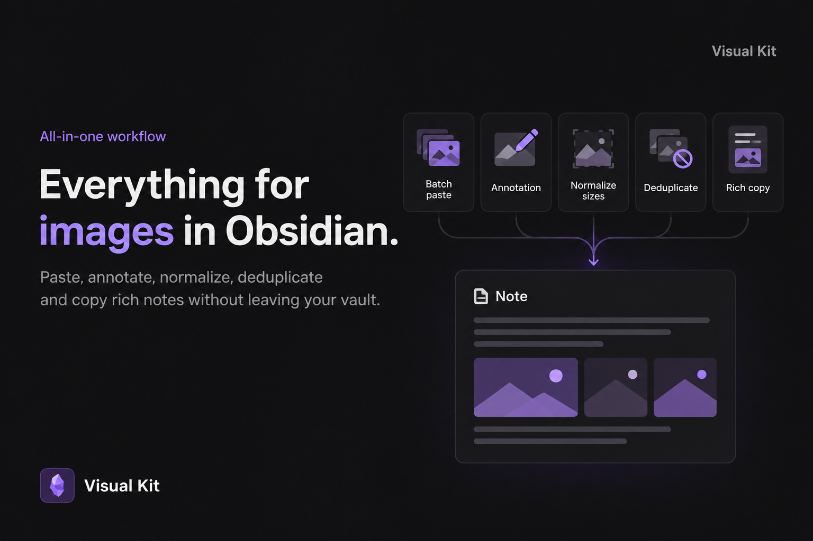

# Visual Kit

**Paste, annotate, and share screenshots without leaving Obsidian.**

A local image toolkit for bug reports, support tickets, and visual documentation.

[Download](https://github.com/pedrohf-dev/visual-kit/releases/latest) · [Support on Ko-fi](https://ko-fi.com/pedrohlf)



## Features

- **Batch paste** — insert several images at once, in their original order.
- **Annotate** — add arrows, shapes, text, numbered markers, highlights, and redactions.
- **Normalize** — give every image in a note or selection a consistent width.
- **Deduplicate** — reuse identical images instead of saving extra copies.
- **Rich copy** — copy formatted text and images together into a rich-text editor.

Save annotated images as new PNGs, keep editable annotations, and undo or redo changes as you work. All image processing happens locally.

## Installation

Requires **Obsidian Desktop 1.8.0 or later**.

1. Download `main.js`, `manifest.json`, and `styles.css` from the [latest release](https://github.com/pedrohf-dev/visual-kit/releases/latest).
2. Place them in `<your-vault>/.obsidian/plugins/visual-kit/`.
3. Restart Obsidian and enable **Visual Kit** under **Settings → Community plugins**.

## Quick start

1. Paste screenshots into a note.
2. Right-click an image and choose **Annotate**.
3. Add your annotations and choose **Save as new**.
4. Run **Visual Kit: Normalize image sizes** to set a consistent width.
5. Select your documentation and run **Visual Kit: Copy for ticket**.

You can also run **Copy with images** from the command palette. Without a selection, copy commands use the entire note. Formatting and image support depend on the destination editor.

### Editor shortcuts

| Shortcut                         | Action                               |
| -------------------------------- | ------------------------------------ |
| `V` / `A` / `R` / `E`            | Select / arrow / rectangle / ellipse |
| `T` / `D` / `N` / `H`            | Text / draw / number / highlight     |
| `Ctrl+Z` / `Ctrl+Shift+Z`        | Undo / redo                          |
| `Ctrl+S`                         | Save                                 |
| `Ctrl+Shift+C`                   | Copy annotated image                 |
| `Ctrl` + scroll / `Space` + drag | Zoom / pan                           |

Use `Cmd` instead of `Ctrl` on macOS. Customize global shortcuts in **Settings → Hotkeys**.

> When sharing redacted evidence, send only the exported PNG. The original image and editable annotation file may still contain the covered information.

## Development

```sh
npm ci
npm run lint
npm run check
npm test
npm run build
```

The installable plugin is generated in `dist/visual-kit`.

## Support

Enjoy using Visual Kit? [Buy me a coffee on Ko-fi](https://ko-fi.com/pedrohlf).

[MIT License](LICENSE)
