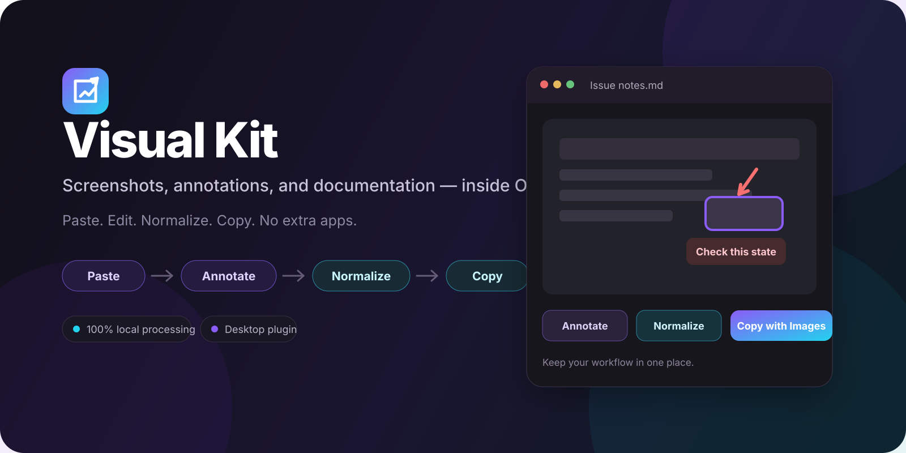
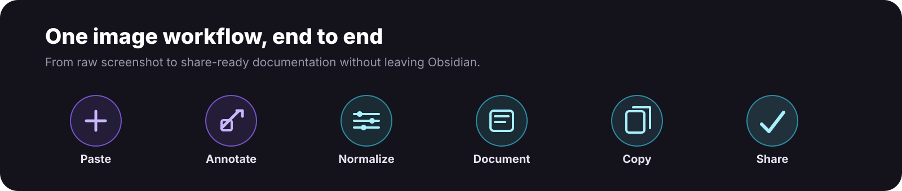

<div align="center">



<br />

# Visual Kit

**A complete image workflow for Obsidian.**

Paste screenshots, annotate them, keep image sizes consistent, remove duplicates, and copy polished documentation with the images intact.

[Get started](#installation) · [See the workflow](#one-workflow-from-screenshot-to-share) · [Features](#everything-you-need-for-image-heavy-notes) · [Commands](#commands)

</div>

---

## Why Visual Kit?

Screenshots are useful — until your workflow becomes:

**capture → save file → rename → open editor → draw arrow → save again → resize → return to Obsidian → copy → fix broken images in your ticket.**

Visual Kit keeps that entire workflow inside Obsidian.

> **Paste → Annotate → Normalize → Document → Copy**

It is designed for anyone who explains things with screenshots: support, product, documentation, development, testing, tutorials, bug reports, and technical notes.

### At a glance

| | |
| --- | --- |
| 🖼️ **Batch paste** | Paste multiple image files at once, in order. |
| ♻️ **Deduplicate** | Reuse byte-identical images instead of filling your vault with copies. |
| ✏️ **Annotate** | Arrows, rectangles, ellipses, text, freehand, highlights, redaction and numbered markers. |
| 📐 **Normalize** | Give every image in a note or selection the same display width in one action. |
| 📋 **Rich copy** | Copy formatted text and local images together for rich-text editors. |
| 🔒 **Local-first** | Images and annotation data stay on your machine. No upload service is required. |

---

## One workflow, from screenshot to share



A typical Visual Kit workflow takes a few seconds:

1. **Paste screenshots** into your note — one or many.
2. **Reuse duplicates** automatically when the same image already exists.
3. **Annotate** the screenshot without opening another app.
4. **Normalize image sizes** so the note looks consistent.
5. **Write your explanation** around the screenshots.
6. **Copy with images** and paste the result into a compatible rich-text editor.

---

## Everything you need for image-heavy notes

### Annotate without leaving Obsidian


Open an image from its embed or context menu and add:

- arrows;
- rectangles and ellipses;
- multiline text;
- freehand drawing;
- numbered markers;
- highlights;
- opaque redaction;
- crop;
- undo / redo.

Annotations can remain editable through a sidecar `.qrc.json` file, while the exported PNG stays portable.

**Save & Copy** lets you save an annotated screenshot and place the rendered result on the clipboard in one action.

---

### Paste multiple images at once

Copy several image files and paste once.

Visual Kit:

- keeps clipboard order;
- generates file names from your template;
- saves them to the configured image folder;
- optionally adds a default width;
- inserts clean embeds with spacing between them.

Example:

```md
![[ticket-1423-01.png|600]]

![[ticket-1423-02.png|600]]

![[ticket-1423-03.png|600]]
```

---

### Stop creating duplicate screenshots

Visual Kit uses **SHA-256 content hashes** to identify exact duplicates.

When the same image is pasted again, you can choose to:

- **Reuse existing** — default;
- **Ask** every time;
- **Always save** a new file.

Duplicate detection never deletes existing images automatically.

---

### Make every screenshot the same size

Run **Visual Kit: Normalize image sizes** and choose a width such as `600 px`.

Before:

```md
![[login.png|820]]
![[error.png]]
![[dashboard.png|450]]
```

After:

```md
![[login.png|600]]
![[error.png|600]]
![[dashboard.png|600]]
```

Only the Markdown display size changes — the original image file is untouched.

You can normalize:

- the entire note;
- the current selection;
- instantly with your configured default width.

---

### Copy notes with the images intact

**Copy with Images** turns the selected Markdown into clipboard content containing both:

- `text/html` with embedded local images;
- `text/plain` as a fallback.

It preserves common rich-text structure including:

- headings;
- bold and italic;
- lists;
- links;
- tables;
- code;
- blockquotes;
- checkboxes;
- image dimensions.

**Copy for Ticket** can also normalize image widths only in the exported HTML, without changing the note.

> Clipboard behavior depends on the destination editor. Visual Kit is designed for rich-text destinations, but Movidesk, Outlook, Gmail, Word and similar apps should still be validated individually.

---

## Quick start

1. Paste one or more screenshots into a note.
2. Right-click an image and choose **Annotate**.
3. Add arrows, boxes or text, then save.
4. Run **Visual Kit: Normalize image sizes** if you want consistent widths.
5. Select the note content and run **Copy for Ticket** or **Copy with Images**.
6. Paste into your destination editor.

That's it.

---

## Installation

### Manual install from a GitHub release

Visual Kit is currently installed manually.

1. Open the [latest release](https://github.com/pedrohf-dev/visual-kit/releases/latest).
2. Download:
   - `main.js`
   - `manifest.json`
   - `styles.css`
3. Create:

```text
Your Vault/
└── .obsidian/
    └── plugins/
        └── visual-kit/
            ├── main.js
            ├── manifest.json
            └── styles.css
```

4. Restart Obsidian.
5. Open **Settings → Community plugins** and enable **Visual Kit**.

> Do not use GitHub's automatically generated source-code ZIP as the installable plugin.

### Build from source

```sh
npm ci
npm run build
```

Copy the generated `dist/visual-kit` directory into your vault's `.obsidian/plugins/` folder.

---

## Commands

All commands appear in the command palette under **Visual Kit**.

| Command | What it does |
| --- | --- |
| **Copy with Images** | Copy the selection or note as formatted rich content with embedded local images. |
| **Copy for Ticket** | Copy rich content with optional export-only image normalization. |
| **Annotate image** | Open the image referenced by the embed under the cursor. |
| **Normalize image sizes** | Choose a width, preset, and scope. |
| **Normalize images using default width** | Instantly apply your configured default width. |
| **Rebuild image duplicate index** | Rebuild the local SHA-256 image index. |

### Copy modes

| Mode | Behavior |
| --- | --- |
| **Smart Copy** — default | Rich copy only when the selection contains images. |
| **Dedicated** | Normal copy stays untouched; use Visual Kit commands explicitly. |
| **Always Rich Copy** | Rich copy is used for every text selection. |

---

## Image editor shortcuts

| Shortcut | Action |
| --- | --- |
| `V` | Select |
| `A` | Arrow |
| `R` | Rectangle |
| `E` | Ellipse |
| `T` | Text |
| `D` | Freehand |
| `N` | Number marker |
| `H` | Highlight |
| `Delete` / `Backspace` | Delete selected object |
| `Ctrl+Z` | Undo |
| `Ctrl+Shift+Z` / `Ctrl+Y` | Redo |
| `Ctrl+S` | Save |
| `Ctrl+Shift+C` | Copy rendered image |
| `Ctrl` + mouse wheel | Zoom |
| `Space` + drag | Pan |

On macOS, use `Cmd` instead of `Ctrl`. Quick normalization defaults to `Ctrl+Alt+I` (`Cmd+Option+I` on macOS). Global shortcuts can be changed in **Settings → Hotkeys**.

---

## Useful settings

| Setting | Default |
| --- | --- |
| Normalized width | `600 px` |
| Apply default width when pasting | Off |
| Blank line between pasted images | On |
| Image folder | `attachments` |
| File name template | `{note}-{date}-{counter}` |
| Duplicate action | Reuse existing |
| Preserve explicit height | Off |
| Normalize on Copy for Ticket | Off |
| Preserve editable annotation data | On |
| Save mode | New image |

Image folders can use values such as `attachments`, `attachments/{note}`, `images`, `same-folder`, or another vault-relative path.

---

## Privacy and safety

Visual Kit performs its image workflow locally.

- No background clipboard polling.
- No remote image editing service.
- No automatic deletion of duplicates.
- No upload API is required for annotation, resize, deduplication or export.
- Vault enumeration is limited to image discovery needed for duplicate handling and image context resolution.

### Redaction note

Opaque redaction is visual until the result is rendered.

When sharing redacted evidence, share the **exported/flattened PNG**, not the original image or editable `.qrc.json` sidecar, because those may still contain the original information.

---

## Current limitations

- **Desktop only.** Windows is the priority platform; macOS and Linux need broader real-world validation.
- Clipboard applications expose image data differently. Some apps may expose only one image even when several items were selected.
- Duplicate matching is exact. Re-encoded or recompressed versions of the same screenshot are treated as different images.
- GIF editing is intentionally conservative: overwriting GIF data with a PNG is prevented.
- Remote images are not downloaded during rich-copy export.
- End-to-end clipboard compatibility still depends on the destination editor.

For validation details, see [VALIDATION.md](VALIDATION.md).

---

## Development

```sh
npm ci
npm run check
npm test
npm run build
```

| Command | Purpose |
| --- | --- |
| `npm run check` | TypeScript checks |
| `npm test` | Logic, workflow, HTML export and rasterization tests |
| `npm run build` | Build `main.js` and `dist/visual-kit` |
| `npm run format` | Format source and docs |

Project structure:

```text
src/
├── clipboard/    # Rich clipboard output
├── duplicates/   # SHA-256 and local duplicate index
├── editor/       # Fabric.js editor, tools, history, persistence
├── paste/        # Clipboard input, batch paste and naming
├── sizing/       # Embed parsing and size normalization
├── main.ts       # Commands, events, menus and settings
└── settings.ts   # Preferences and defaults
tests/
docs/
```

Visual Kit uses [Fabric.js](https://fabricjs.com/) for image editing and is licensed under the [MIT License](LICENSE).

See the [v2.2 specification](docs/spec-v2.2.md) for the product requirements and planned features.

---

## Roadmap

Ideas planned for future versions include:

- batch **Paste & Annotate**;
- **Save & Next** for reviewing several screenshots;
- dedicated screenshot capture shortcut;
- perceptual duplicate detection;
- guided duplicate cleanup;
- blur / pixelation;
- section-level normalization;
- JPEG / WebP export.

---

## Support

If Visual Kit makes your image workflow easier, you can support continued development:

**[☕ Buy me a coffee on Ko-fi](https://ko-fi.com/pedrohlf)**

Bug reports, feature ideas and pull requests are welcome.

<div align="center">

**Visual Kit**

*Keep the screenshot workflow where the documentation already lives.*

</div>
